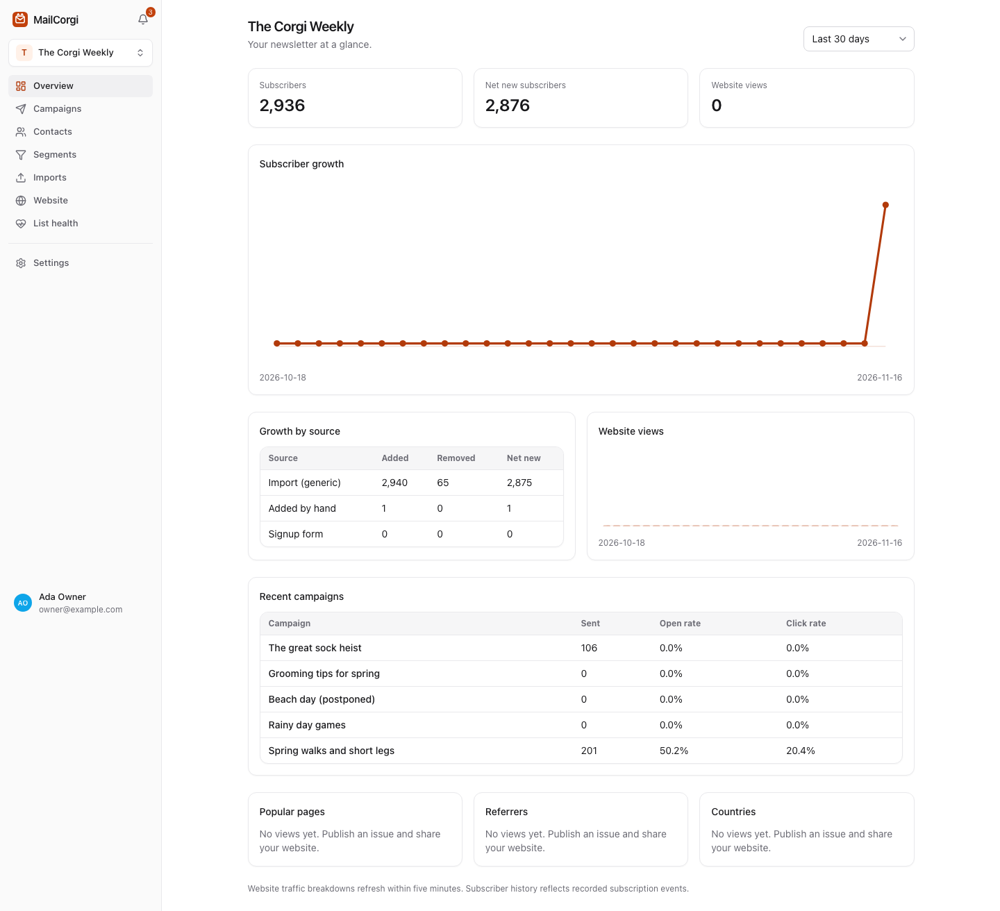
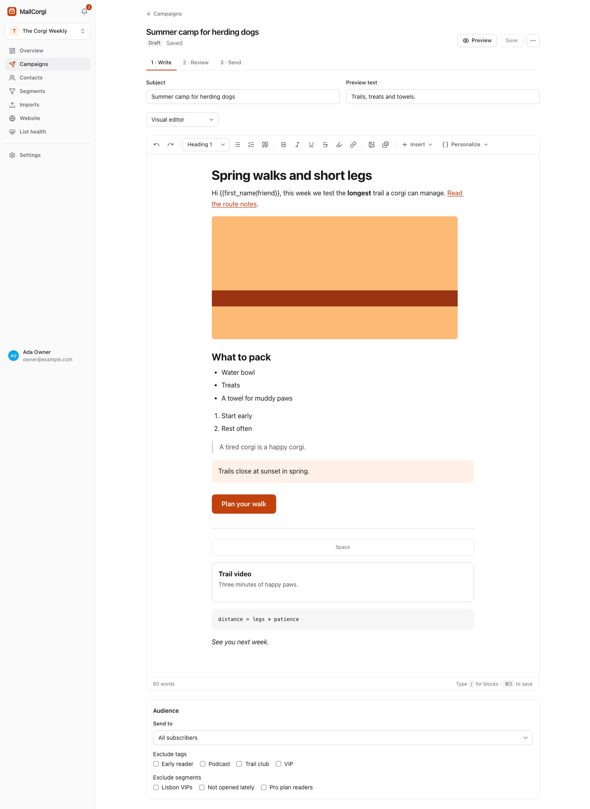
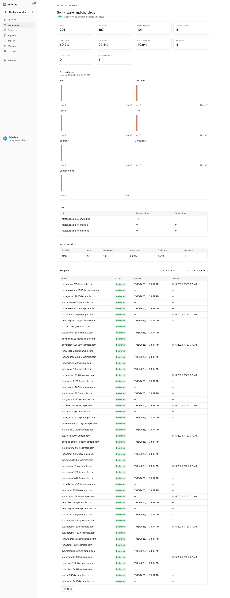
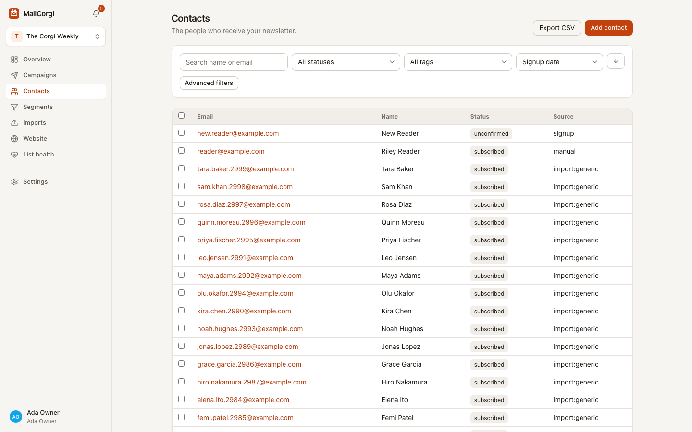
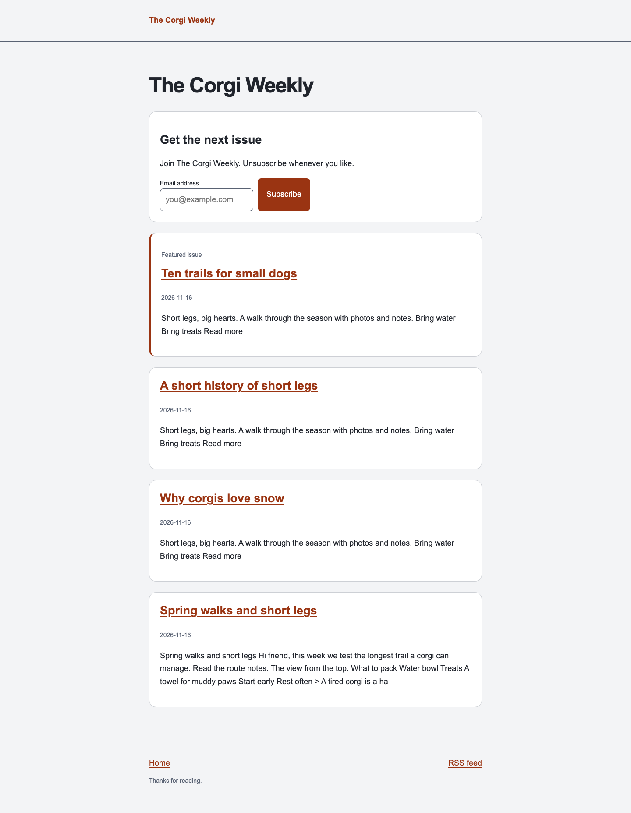
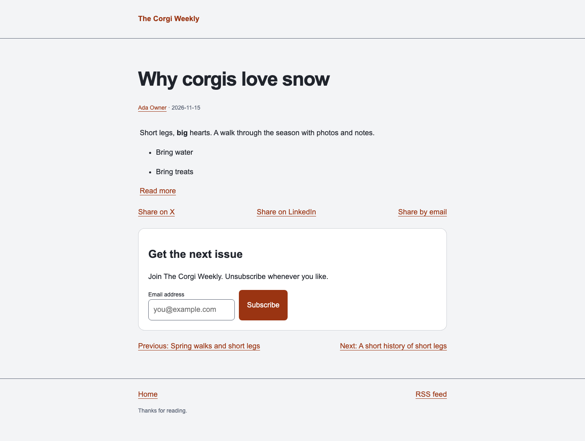

# MailCorgi

MailCorgi is a newsletter app you run yourself. Write an issue, send it to your list, and publish it on
your own website. It runs on Cloudflare Workers with one click, or on any server with Docker.

[](https://deploy.workers.cloudflare.com/?url=https://github.com/rizaardiyanto1412/mailcorgi)

You bring the email provider (Amazon SES, Resend or any SMTP server) and pay it directly. MailCorgi
keeps your list, your issues and your stats in SQLite databases that you own.

## Features

**Writing and sending**

- A block editor with headings, lists, quotes, code, images, buttons, callouts, dividers and link cards.
  The API and MCP also accept Markdown and HTML.
- Merge fields such as `{{first_name|there}}`, a send preview and test emails to up to 5 addresses.
- A review step that checks the subject, preview text, unsubscribe link, size against Gmail's clipping
  limit, postal address, sender domain, image alt text and links.
- Schedule, pause, resume and cancel. Gradual sending for addresses you never emailed before, with an
  automatic pause when bounces or complaints cross a safe rate. "Send to more now" and resuming a
  paused send follow the same check. Send to the most engaged readers first.
- One-click unsubscribe headers (RFC 8058) on every email.

**Your list**

- Contacts with search, filters, tags, custom fields, a timeline per contact and CSV export.
- Segments built from status, tags, fields, dates, source, engagement and inbox provider.
- Signup forms: a hosted page, an embed script and a JSON endpoint. Double opt-in by default, a
  welcome email, and spam limits per visitor (honeypot, rate limits, optional Cloudflare Turnstile).
- CSV imports with presets for beehiiv, Substack, Mailchimp, Kit, MailerLite, Buttondown, Ghost,
  EmailOctopus and listmonk. Imports leave out invalid, misspelled, role, disposable, duplicate and
  suppressed addresses, and report each reason. Rows without a subscribed status and confirmed consent
  are added as unconfirmed and get no email; the import says so before it starts and in its report.
- List hygiene: readers who ignore many issues in a row get one "still interested?" email and are
  removed if they do not click.

**Delivery and tracking**

- Sending domains with the DNS records to publish and a daily recheck. SES and Resend identities are
  created for you.
- Bounce and complaint webhooks from SES and Resend update contacts and suppressions on their own.
- Open and click tracking that leaves out link scanners and security bots.
- Campaign reports and an overview of subscribers over time, growth by source and website views.
- Notifications in the app, and alerts for install admins.

**Website**

- A public site for each newsletter at `/n/<slug>` or on your own domain: home page with a signup form,
  issue pages, author pages, RSS, sitemap, Open Graph tags and JSON-LD.
- Privacy-friendly page view counts without cookies, plus Plausible, Google Analytics, Fathom or Umami
  if you want them.

**Teams and automation**

- Invite people to each newsletter as admins or members. A self-hosted install has no limits on
  newsletters, contacts, team size or emails. In cloud mode the plan sets each limit, including how
  many people a newsletter can have (2 on the free plan).
- API keys with full or read-only access, a REST API with OpenAPI docs at `/docs/api`, and an MCP
  server at `/mcp` so AI assistants can draft and send through the same rules as the dashboard.

**Running it**

- An admin console with a setup checklist, email provider settings, accounts, alerts, failed jobs and
  global suppressions.
- Cloud mode (`CLOUD=true`) turns an install into a hosted service: open sign-up with emailed codes,
  plans with limits, and billing through Stripe or Polar.

## Screenshots

| | |
| --- | --- |
|  |  |
|  |  |
|  |  |

`npm run ui:pass` captures every page in light and dark, at desktop and phone width (see [docs/development.md](docs/development.md#browser-pass-and-screenshots)).

## Install

### Cloudflare (one click)

1. Click **Deploy to Cloudflare** above. Cloudflare copies the repository to your GitHub or GitLab
   account, creates the Durable Objects and the R2 bucket, then builds and deploys the Worker.
2. Open the `*.workers.dev` address that Cloudflare shows and create the first account. It becomes the
   install admin.
3. Go to **Admin → Setup** and work through the checklist.

No secrets are needed to deploy. R2 must be enabled on your Cloudflare account once. If you do not want
R2, delete the `r2_buckets` block in `wrangler.jsonc` and images are stored inside the Durable Objects.
The [Cloudflare section of the self-hosting guide](docs/self-hosting.md#run-on-cloudflare) covers custom
domains and Workers Free limits.

### Docker

```sh
git clone https://github.com/rizaardiyanto1412/mailcorgi.git
cd mailcorgi
docker compose up -d
```

Open <http://localhost:3000> and create the first account. On a server with a domain name, use the
installer instead. It asks for your domain and turns on HTTPS:

```sh
curl -fsSL https://raw.githubusercontent.com/rizaardiyanto1412/mailcorgi/main/scripts/install.sh | sh
```

## Guides

- [Self-hosting guide](docs/self-hosting.md): first run, email providers, DNS, custom domains, backups,
  upgrades and every environment variable.
- [Cloud mode](docs/cloud-mode.md): run MailCorgi as a paid service with Stripe or Polar.
- [API](docs/api.md): REST and MCP.
- [Architecture](docs/architecture.md): how the code fits together.

## How this differs from a newsletter SaaS

A hosted newsletter service charges by list size and holds your list. With MailCorgi you pay your
email provider per email (Amazon SES costs about $0.10 per 1,000) and keep the data. You also take on
what the service did for you: you set up the provider and your DNS, you watch your sender reputation,
and you back up your data. MailCorgi helps with the first two through the setup checklist, domain
checks, gradual sending and automatic pauses. Backups are one command; the guide shows it.

## Develop

```sh
npm ci
npm run dev     # the API server and the Vite dev server, with reload on save
npm run ci      # typecheck, lint, tests, build, and smoke tests on Node and wrangler dev
```

Read [docs/development.md](docs/development.md) before you add a feature.

## License

[AGPL-3.0-only](LICENSE). If you run a modified MailCorgi for other people, you must offer them your
source code.
